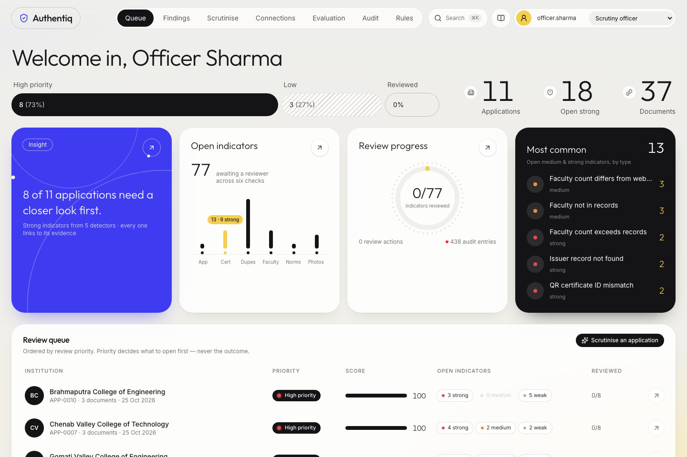
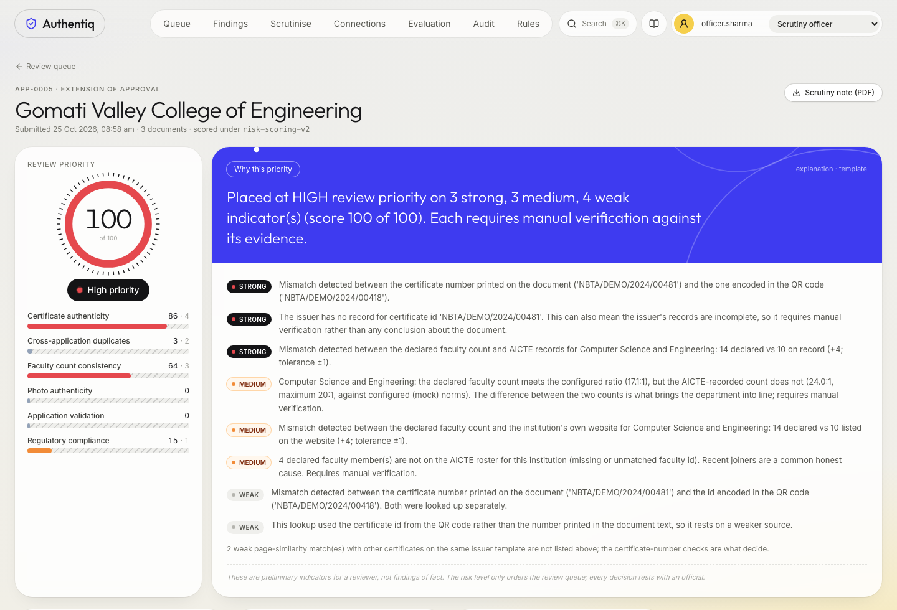
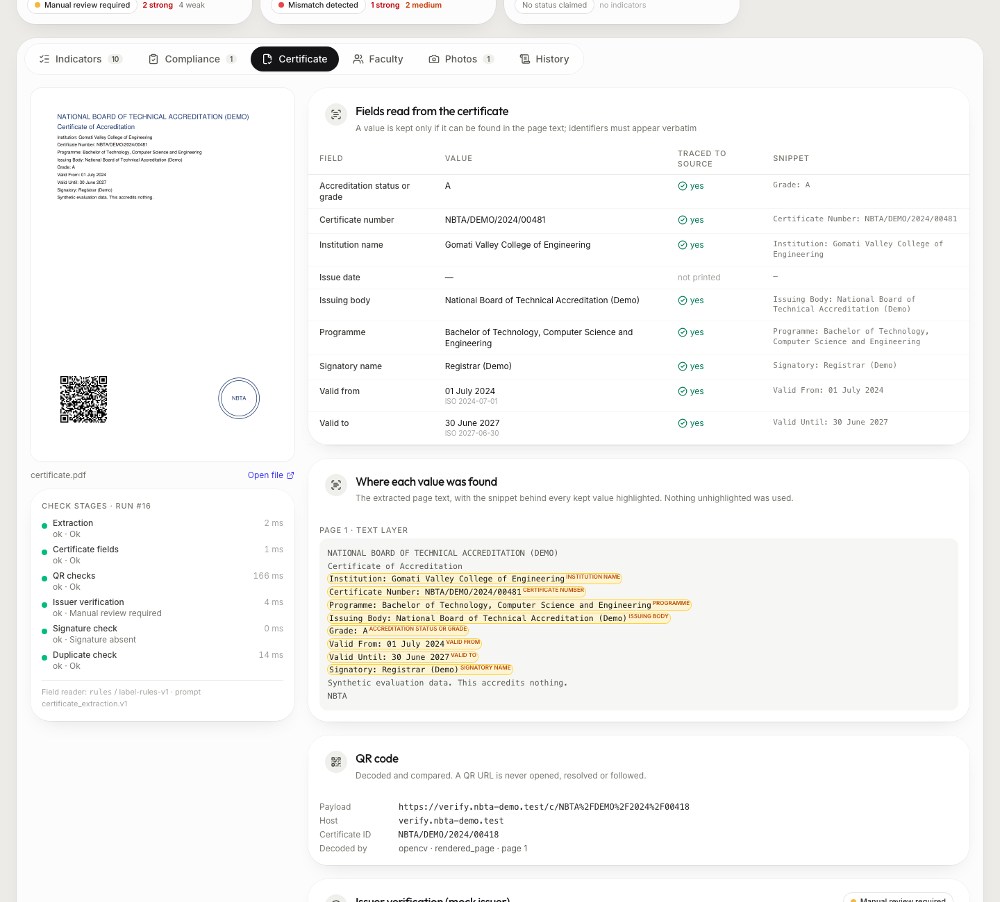
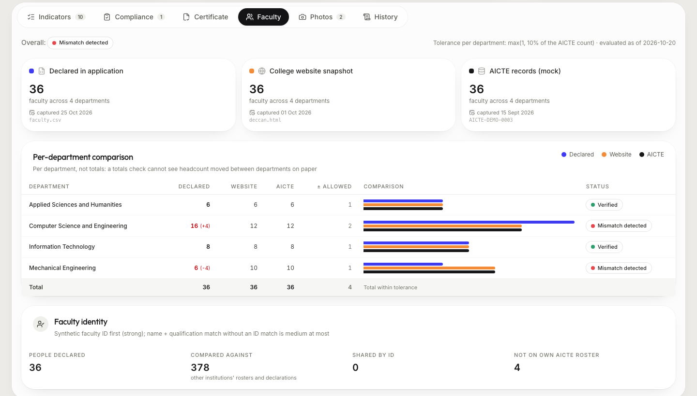
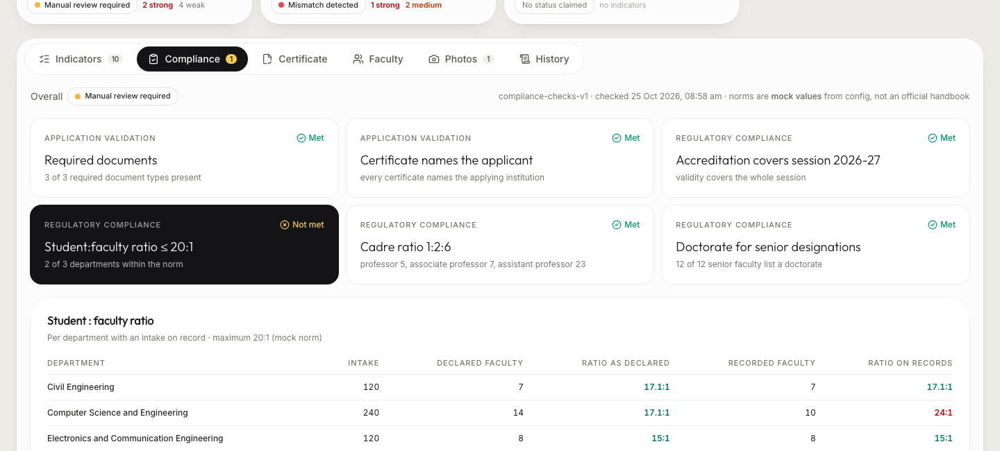
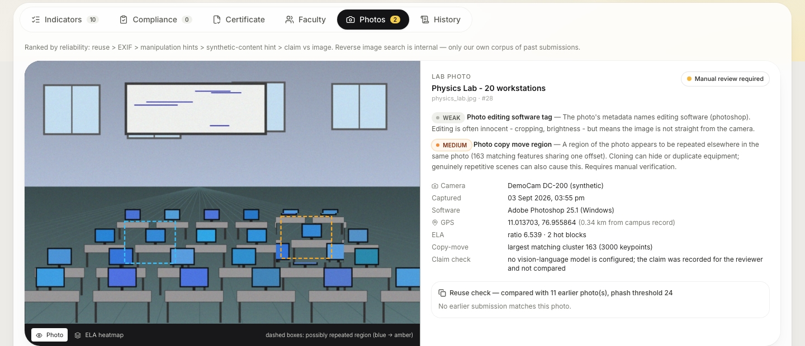
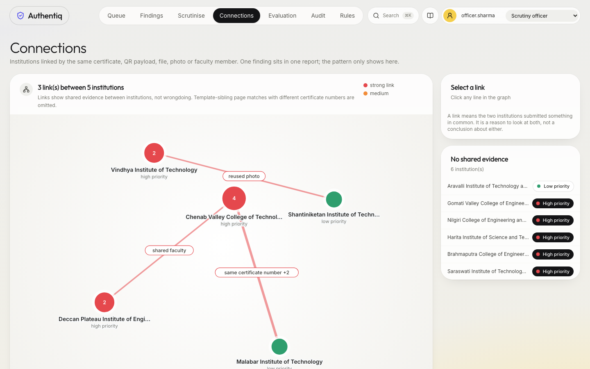

<div align="center">

# Authentiq

### AI-assisted scrutiny for AICTE Extension of Approval applications

**Smart India Hackathon 2026 · Problem statement SIH26261**<br/>
*AI-Powered Application Validation, Document Authentication and Regulatory Compliance Verification*


<p align="center">
  <a href="https://drive.google.com/file/d/1oI86Y7J7cBgEzf35xttYyKb6ITUx1fEz/view?usp=drive_link">
    
  </a>
</p>


</div>

Authentiq reads an institution's application — the accreditation certificate,
the faculty list and the lab and classroom photographs — and raises **possible
issues, each with its evidence**, for an AICTE official to verify. It orders the
review queue so the riskiest files are opened first.

It **never approves or rejects** anything, and never calls a document fake. Every
output is a preliminary indicator with the reason, the values compared, the
source consulted and a confidence.

> **All data in this repository is synthetic.** Every institution, person,
> certificate, faculty list and photo is invented; every domain uses the
> reserved `.test` TLD. No real AICTE or issuer system is contacted.

---

## Contents

[Quick start](#quick-start) · [What it checks](#what-it-checks) · [Screens](#screens) · [Results](#results) · [How a submission flows](#how-a-submission-flows) · [Design principles](#design-principles) · [Check by check](#check-by-check) · [Risk scoring](#risk-scoring) · [API](#api) · [Configuration](#configuration) · [Testing](#testing) · [Repository layout](#repository-layout) · [Limitations](#limitations-and-next-steps)

---

## Quick start

```bash
python3.12 -m venv .venv                    # any Python 3.10–3.12 (see Requirements)
.venv/bin/pip install -r backend/requirements.txt
(cd frontend && npm install)
./run_demo.sh
```

**Windows (PowerShell):**

```powershell
py -3.12 -m venv .venv
.venv\Scripts\pip install -r backend\requirements.txt
cd frontend; npm install; cd ..
powershell -ExecutionPolicy Bypass -File .\run_demo.ps1
```

The `-ExecutionPolicy Bypass` flag is per-invocation and does not change your
machine's policy. Switches: `-ApiPort 8800` (also honours `API_PORT`),
`-SkipGenerate` / `-SkipEvaluate` for faster repeat runs,
`-Offline` to force the offline reader for this run only (the `.env` file is
not touched), `-CheckOnly` to run preflight and exit. If preflight fails it
prints what to fix (venv missing, wrong Python, missing packages, port busy,
Node too old).

Open **http://localhost:5175**. The script generates the synthetic dataset, runs
all eleven demo applications through the real pipeline into a fresh database,
measures detection and false positives, and starts the API (`127.0.0.1:8765`)
and the dashboard.

**No API key is needed.** Without one, certificate fields are read by an offline
label reader that returns the same contract as the model and passes the same
evidence checks. With a free Groq key in `.env` (`GROQ_API_KEY=...`), the LLM is
used instead — and if the key is set but the provider cannot be reached (no
network, a timeout, a rejected key), the offline reader still takes over rather
than failing the check. When it does, the certificate shows a small **"Offline
reader"** badge, with the reason in its tooltip; the reading is honest and was
checked the same way, it simply did not come from the model.

**Roles.** You start as a scrutiny officer, who reviews findings and submits
applications. The audit trail and re-runs need a senior role: pick it in the
header and sign in with its passcode. The demo passcodes are synthetic and live
only as hashes in [`api.yaml`](config/api.yaml):

| Role | Demo passcode | Adds |
|---|---|---|
| Senior reviewer | `senior@2026` | Audit trail, hash-chain verification, re-runs |
| Administrator | `admin@2026` | Same, for the people who maintain the rules |

Change them with `cd backend && ../.venv/bin/python -m app.api.passcode <role>`.

<details>
<summary><b>Running the pieces separately</b></summary>

```bash
cd backend
../.venv/bin/python -m demo.generate          # synthetic certificates, CSVs, photos, records
../.venv/bin/python -m demo.load --fresh      # run them through the pipeline
../.venv/bin/python -m demo.evaluate          # detection / false-positive report
../.venv/bin/python -m app.api                # API on 127.0.0.1:8765 (docs at /docs)

cd ../frontend && npm run dev                 # dashboard on localhost:5175
```

If `demo.evaluate` (or `demo.load`, or `evaluation.run`) says the generated
data was not found, run `python -m demo.generate` first (`python -m
evaluation.generate` for the evaluation set) — the generated files are
gitignored output, not shipped.

**Requirements.** Python **3.10–3.12** — a hard limit, because
`rapidocr-onnxruntime` declares `Requires-Python <3.13`. Node 20+.
</details>

---

## What it checks

Five checks feed one review queue. Strength is set by deterministic code from
configuration — never by a model.

| | Check | Signals |
|---|---|---|
| 📄 | **Certificate authenticity** | Text layer or OCR → nine fields, each traced back to the page · QR decoded and compared, domain allowlist, **never opened** · mock issuer lookup, field by field · PDF signature integrity (modified after signing?) · duplicates by file hash, certificate number, QR payload and page image |
| 👥 | **Faculty consistency** | Declared list vs college-website snapshot vs AICTE records (mock), **per department** with tolerance · capture date of each source · staff moved between departments on paper · the same faculty ID claimed by two colleges |
| 📷 | **Photo authenticity** | Reuse against our own corpus (mirrored copies too) · EXIF capture date, GPS vs campus, editing software · error-level analysis heatmap · cloned (copy-move) regions · image-generator markers — a low-confidence hint only |
| 📋 | **Application & compliance** | Required documents present · **certificate names the institution that is applying** · accreditation covers the session · student : faculty ratio, cadre ratio and doctorate norms — on the declared *and* the AICTE-recorded counts |
| 🎯 | **Review priority** | Weighted, explainable score per check and overall → low / medium / high. **Orders the queue; decides nothing.** |

---

## Screens

| | |
|---|---|
|  **Application** — priority ring, per-check sub-scores and a plain-language *why*. |  **Certificate** — every value highlighted where it was read; QR vs printed number; issuer comparison. |
|  **Faculty** — three sources per department. Totals match, departments don't: headcount moved on paper. |  **Compliance** — norms met only on the declared count, not on the AICTE records. |
|  **Photos** — EXIF, ELA heatmap toggle, cloned regions boxed on the image, reuse matches. |  **Connections** — institutions linked by a shared certificate, photo or faculty member. |

Also: live stage-by-stage progress while an application is checked, a **PDF
scrutiny note** for the file, **⌘K search** ("where else does this certificate
number appear?"), run history with diffs, a hash-chained audit trail with
one-click verification, and every rule file shown read-only with its version.

---

## Results

`python -m demo.evaluate` — eleven synthetic applications, run on a fresh
temporary database. Labels come from the generator's recipes, never from a
detector.

| Injected issue | Detected |
|---|:---:|
| Certificate number edited by one digit (incl. after digital signing) | **2 / 2** |
| QR pointing at a look-alike verification domain | **1 / 1** |
| Another institution's certificate number reused | **1 / 1** |
| A genuine certificate of *another* institution submitted as one's own | **1 / 1** |
| Inflated faculty (incl. redistribution between departments) | **2 / 2** |
| Same faculty claimed by two institutions | **1 / 1** |
| Reused lab photo (mirrored, shrunk, recompressed) | **1 / 1** |
| Image-generator marker on a classroom photo | **1 / 1** |
| Photo manipulation (cloned region, pasted patch) | **1 / 1** |
| Photo geotagged far from campus / dated after upload | **1 / 1** |

- **False positives: 0** medium-or-strong indicators on the three clean controls, all at low priority.
- **Honest documents still surfaced:** a revoked certificate, an expired one and an incomplete application are flagged and reported separately. They need a reviewer even though nothing is wrong with the institution's honesty.
- **About 0.4 s per application** (≈0.12 s per document) on a laptop.

> These rates show the checks work as designed. The photo thresholds were
> measured on the same synthetic renders, so they are **not** a claim about
> real-world accuracy. A larger certificate-only evaluation (80 applications,
> five layouts, four noise levels, dev/holdout split) lives in
> [`backend/evaluation`](backend/evaluation/).

---

## How a submission flows

```
                upload (PDF · JPG/PNG · CSV)
                            │
          content-addressed store  ·  one document row per file
                            │
        ┌───────────────────┼─────────────────────┐
        ▼                   ▼                     ▼
  CERTIFICATE          FACULTY LIST            PHOTO
  1 text layer / OCR   declared CSV            1 EXIF / metadata
  2 fields (LLM or     website snapshot        2 reuse vs corpus
    label reader),     AICTE records (mock)    3 ELA + copy-move
    traced to source   per department,         4 synthetic hint
  3 QR cross-check     tolerance, identity     5 claim vs image
  4 issuer lookup                                (VLM, advisory)
  5 signature
  6 duplicates
        └───────────────────┼─────────────────────┘
                            ▼
              APPLICATION-LEVEL CHECKS
     completeness · applicant identity · session coverage
     student:faculty ratio · cadre ratio · qualifications
                            ▼
                 RISK SCORING  →  review queue
                            ▼
     every stage, finding, review and read → hash-chained audit log
```

Errors are **data**, not crashes. A corrupt file, an unreachable issuer and a
certificate with no grade printed on it are all ordinary results with a status
and a reason. Each stage commits on its own, and a skipped stage is recorded
with why, so a missing check never looks like a passed one.

---

## Design principles

| | |
|---|---|
| **No automated decision** | There is no approve/reject endpoint. Indicators route to a person; the risk level only orders the queue. |
| **The model reads; code decides** | An LLM may only extract fields from messy text or rephrase an explanation. Every value it returns must be found in the source text — identifiers verbatim — or code discards it. No status, strength or score ever comes from a model. |
| **Evidence on every flag** | Each indicator carries its reason, the values compared, the source consulted and a confidence. |
| **Never fetch a URL from a document** | A QR link is evidence, not an address. The issuer URL comes from config only. Both enforced by tests that poison the network. |
| **Nothing is overwritten** | Re-runs add runs; each stores the rule versions and hashes it was judged under. Every priority assessment is kept as history. An indicator identical to one already reviewed keeps that review, marked as carried forward; anything that changed starts open again. |
| **Tamper-evident audit trail** | Append-only and hash-chained, so editing or deleting an entry breaks the chain. It records checks, sources consulted, findings, reviews, report reads, searches and exports — ids and counts only, never document text. |
| **Careful language** | "Mismatch detected", "requires manual verification", "possible synthetic content". Never "fake", "forged" or "deepfake" — asserted by test, including on generated PDFs. |
| **Everything is configuration** | Every threshold, weight, tolerance, allowlist and norm lives in versioned YAML. |

---

## Check by check

<details open>
<summary><b>Certificate authenticity</b> — <code>app/extraction</code> · <code>app/certificates</code> · <code>app/qr</code> · <code>app/issuer</code> · <code>app/signatures</code> · <code>app/duplicates</code></summary>

- **Text** — the PDF text layer is *scored* (character count, word count, readable-character ratio) rather than trusted; OCR (RapidOCR, no system binary) is the fallback. Each page records which route was taken and why.
- **Fields** — nine fields. A value survives only if its quoted snippet is found in the page. For identifiers (certificate number, grade, dates) the value itself must also appear verbatim: a number altered by one digit still scores ~0.97 on fuzzy match, so fuzzy alone is unsafe.
- **QR** — decoded from the rendered page *and* from embedded images; compared with the printed number. The allowlist matches by equality or dot boundary, never `endswith`, which would accept `verify.nbta-demo.test.evil.test`. Mixed-script homoglyphs are checked per host label.
- **Issuer** — the mock issuer is asked about the printed number, plus the QR id at lower trust when they differ. Comparison is field by field. A not-found routes to a human, never to a conclusion.
- **Signature** — integrity only: does the signed byte range still hash to what was signed, and was anything appended? The signer is **not** verified (no trust store), so an intact signature is **neutral** and never lowers priority.
- **Duplicates** — exact file hash, certificate number, QR payload and a 256-bit page hash, all against our own corpus. Severity depends on context: the same file from *another* institution is strong; a resubmission is weak.

Details: [extraction](backend/app/extraction/README.md) · [qr](backend/app/qr/README.md) · [issuer](backend/app/issuer/README.md) · [signatures](backend/app/signatures/README.md) · [duplicates](backend/app/duplicates/README.md)
</details>

<details>
<summary><b>Faculty consistency</b> — <code>app/faculty</code></summary>

Three sources, **per department** — a totals check would pass staff moved from Mechanical to CSE on paper (`faculty_counts_redistributed`). Tolerance is `max(1, 10%)` of the AICTE count. Declared *above* records is the inflation pattern (strong past 25%); declared below is a weak note. A shared synthetic faculty ID across colleges is strong; a name + qualification match without an ID match is medium at most. Website snapshots are local files only, confined to one directory. → [README](backend/app/faculty/README.md)
</details>

<details>
<summary><b>Photo authenticity</b> — <code>app/photos</code></summary>

Ranked by reliability, and strengths follow the ranking: **reuse** (phash vs our own corpus, mirrored too) > **EXIF** (date after upload, GPS > 5 km from campus, editing software; missing EXIF is weak only) > **ELA + copy-move** (hints, never strong) > **synthetic hint** (generator markers in the file's own metadata; fixed wording, low confidence) > **claim vs image** (needs a VLM; with none configured it records `source_unavailable` instead of guessing). Every threshold was measured and is recorded in [`photo_checks.yaml`](config/photo_checks.yaml). → [README](backend/app/photos/README.md)
</details>

<details>
<summary><b>Application validation & regulatory compliance</b> — <code>app/compliance</code></summary>

Runs once all documents are in, over the whole application.

- **Completeness:** the required documents for the category.
- **Applicant identity:** the certificate's institution vs the applicant, with abbreviation-aware matching. A genuine certificate of *another* college passes the issuer lookup, and only this comparison catches it.
- **Session coverage:** the accreditation is valid across the session applied for.
- **Norms:** student:faculty ratio per department, evaluated on the declared count **and** the AICTE-recorded count (`compliance_met_only_as_declared` shows inflation with a motive), plus the cadre ratio and a doctorate for senior designations.

The norms in [`compliance_checks.yaml`](config/compliance_checks.yaml) are **mock values**, labelled as such in every result.
</details>

---

## Risk scoring

Points per indicator by strength (strong 40 · medium 15 · weak 4, overridable
per type) × confidence. Repeats of one type decay, so ten missing-EXIF photos are
one observation. Points sum into a sub-score per check, and a weighted sum gives
0–100, banded into **low / medium / high**. Floors ensure a single strong
indicator is never averaged away.

**Additive only.** A verified lookup, an intact signature or the absence of
indicators adds nothing, and nothing subtracts, except an official dismissing an
indicator. That is recorded, the application is re-scored and the history is
kept. The plain-language explanation is a deterministic template; an optional
LLM rewrite is discarded if it adds a number or uses a banned word.

---

## API

FastAPI with interactive docs at `http://127.0.0.1:8765/docs`. An officer names
themselves in the `X-Actor` / `X-Role` headers. Senior reviewer and admin cannot
be claimed in a header (the API answers 401): `POST /api/session` with the
role's passcode returns a signed, expiring token, sent as
`Authorization: Bearer …`, and the token alone sets actor and role. Sign-ins,
refused attempts and sign-outs are audited; the passcode never is. Permissions
per action live in [`api.yaml`](config/api.yaml), and every read, including each
evidence image, is audited under the person viewing it.

| | Endpoint | |
|---|---|---|
| `POST` | `/api/session` · `/api/session/end` | Sign in to a senior role with its passcode; sign out |
| `POST` | `/api/applications` · `/api/applications/stream` | Submit documents (streamed: one JSON line per stage) |
| `POST` | `/api/demo/samples/{key}/submit` · `/stream` | Run a demo sample through the pipeline |
| `GET` | `/api/applications` · `/{id}/report` · `/{id}/audit` | Queue, full evidence report, audit entries (senior reviewer / admin) |
| `POST` | `/api/applications/{id}/rerun` | New runs under current rules (senior reviewer / admin) |
| `GET` | `/api/applications/{id}/export.pdf` | Scrutiny note for the file |
| `GET` / `POST` | `/api/findings` · `/api/findings/{id}/review` | Cross-application queue; confirm / dismiss / request info / comment |
| `GET` | `/api/network` · `/api/search?q=` | Connections graph; search certificate numbers, faculty, institutions |
| `GET` | `/api/documents/{id}/preview.png` · `/ela.png` · `/file` | Evidence images and the stored file |
| `GET` | `/api/audit` · `/api/audit/verify` | Audit log and hash-chain verification (senior reviewer / admin) |
| `GET` | `/api/stats` · `/api/config` · `/api/evaluation` · `/api/meta` | Dashboard figures, rule files, evaluation report |

---

## Configuration

No threshold, weight, tolerance, allowlist or norm is hard-coded. Every file has
a `config_version` stamped onto each result it produces.

| File | Governs |
|---|---|
| [`extraction.yaml`](config/extraction.yaml) | Text-layer scoring, OCR, render DPI |
| [`certificate_extraction.yaml`](config/certificate_extraction.yaml) | LLM provider/model, offline fallback, snippet & exact-value rules |
| [`qr_checks.yaml`](config/qr_checks.yaml) | Decoders, domain allowlist, finding strengths |
| [`issuer_verification.yaml`](config/issuer_verification.yaml) | Issuer URL, retries, comparison rules, status mapping |
| [`signature_checks.yaml`](config/signature_checks.yaml) · [`duplicate_checks.yaml`](config/duplicate_checks.yaml) | Signature strengths; hash kinds, thresholds, severity by context |
| [`faculty_checks.yaml`](config/faculty_checks.yaml) | Sources, staleness, department aliases, tolerance, identity |
| [`photo_checks.yaml`](config/photo_checks.yaml) | Reuse, EXIF, ELA and copy-move thresholds (measured), generator markers |
| [`compliance_checks.yaml`](config/compliance_checks.yaml) | Required documents, applicant matching, session, **mock** norms |
| [`risk_scoring.yaml`](config/risk_scoring.yaml) | Points, overrides, weights, levels, floors |
| [`explanations.yaml`](config/explanations.yaml) · [`persistence.yaml`](config/persistence.yaml) · [`api.yaml`](config/api.yaml) | Language guard; database, roles, review lifecycle; ports, permissions |

The fixed verification statuses — `verified` · `mismatch_detected` · `expired` ·
`verification_pending` · `source_unavailable` · `manual_review_required` — are
defined once in [`core/verification.py`](backend/app/core/verification.py) and set
by code only.

---

## Testing

```bash
cd backend
../.venv/bin/python -m pytest                              # 442 tests, ~2 min
../.venv/bin/python -m pytest -m "not ocr and not qr and not slow and not llm"   # fast subset
```

| Marker | Meaning |
|---|---|
| *(none)* | Fast; no network, no models |
| `ocr` · `qr` | Real OCR models / real image decoding |
| `slow` | Builds the demo or evaluation dataset end to end |
| `llm` | Calls a real API — skipped without a key, **fails** if a key is present but rejected |

Notable tests:
- No-network traps around the QR, issuer, photo-reuse and evaluation paths.
- Every generated finding, explanation and PDF is checked for banned words.
- Altering a row is shown to break the audit chain, even with the database triggers dropped.
- Duplicate detection gives the same result in either processing order.
- The demo evaluation is asserted at 100% detection with zero false positives.

---

## Repository layout

```
backend/
  app/
    extraction/  certificates/  llm/  qr/  issuer/  mock_issuer/
    signatures/  duplicates/  similarity/            certificate checks
    faculty/                                          faculty consistency
    photos/                                           photo authenticity
    compliance/                                       application & compliance
    scoring/  explain/                                review priority, explanation
    pipeline/  db/  api/                              orchestration, storage, REST
    core/  reports/  audit/                           config, taxonomy, CLIs
  demo/          synthetic demo world: generate · load · evaluate
  evaluation/    80-application certificate evaluation (dev/holdout)
  tests/         fixtures generated by script, never committed
frontend/        React 19 + TypeScript + Tailwind 4 (Vite)
config/          every rule, threshold and norm, versioned
data/demo/       issuer registry, mock AICTE records, website snapshots
docs/screenshots/
CLAUDE.md        design decisions and the reasoning behind each
```

**Stack:** Python · FastAPI · SQLAlchemy 2 (SQLite; Postgres-ready) · PyMuPDF ·
RapidOCR · OpenCV · zxing-cpp · pyHanko · imagehash · React 19 · TypeScript ·
Tailwind 4 · Vite.

---

## Limitations and next steps

- **Synthetic only.** Thresholds were measured on synthetic renders; real submissions need re-measurement before any numbers are trusted.
- **Mock sources.** The issuer service, AICTE records and compliance norms are stand-ins, to be replaced by official interfaces and an official handbook configuration.
- **Shared role passcodes, not personal accounts.** Senior roles need a passcode and carry a signed token; an officer still names themselves. A deployment would replace both with the department's SSO.
- **Claim vs image** needs a vision-language model. The seam exists and records `source_unavailable` until one is configured.
- **A cropped photo defeats a whole-image hash.** Region matching would catch it.
- **Signer identity is not verified**, by design for the prototype (no trust store).

---

<div align="center">

**[CLAUDE.md](CLAUDE.md)** has the full record of design decisions and why each was made.

*Preliminary indicators for review, not findings of fact.*

</div>
---
